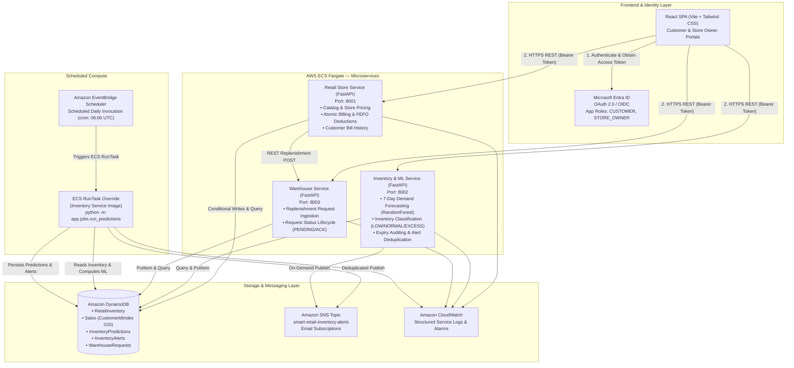

# System Architecture Documentation

## Overview

The **Smart Retail Inventory and Demand Forecasting System** is a production-grade, multi-cloud retail management platform. The application provides store operations management, customer self-service checkout with atomic stock deductions, First-Expiry-First-Out (FEFO) batch tracking, machine learning demand forecasting, automated stock alerting, and warehouse replenishment.

The system is designed with exactly three business microservices running as independent Docker containers on AWS ECS (Fargate), backed by Amazon DynamoDB, and secured by Microsoft Entra ID.

---

## Architecture Diagram

---

## Architectural Components

### 1. Frontend Single Page Application (SPA)
- **Framework:** React 18, Vite, JavaScript, Tailwind CSS.
- **Routing & State:** React Router DOM, React Context (`AuthContext`, `CartContext`).
- **Data Visualization:** Recharts for 7-day demand forecasts, stock coverage comparisons, and category distributions.
- **Authentication:** MSAL React (`@azure/msal-react`, `@azure/msal-browser`) authenticating against Microsoft Entra ID. Includes a developer profile switcher for rapid offline development.
- **Security Rule:** The frontend never connects directly to DynamoDB or AWS resources; all actions flow through authenticated REST APIs.

### 2. Retail Store Service (Port 8001)
- **Framework:** Python 3.12 / FastAPI / Uvicorn.
- **Core Role:** Store product catalog, authoritative pricing, and atomic customer checkout.
- **Billing Correctness Engine:**
  - Evaluates non-expired stock across individual batches.
  - Allocates stock decrements via First-Expiry-First-Out (FEFO) ordering.
  - Prevents race conditions and negative inventory using DynamoDB `ConditionExpression: "totalStock >= :qty"`.
  - Enforces duplicate prevention via idempotency keys.
  - Queries customer purchase history using the `CustomerIdIndex` Global Secondary Index (GSI) on the `Sales` table to ensure complete data isolation.

### 3. Inventory and ML Prediction Service (Port 8002)
- **Framework:** Python 3.12 / FastAPI / scikit-learn / joblib / pandas / NumPy.
- **Core Role:** Demand forecasting, stock tier classification, batch expiry auditing, and persistent alerting.
- **ML Engine:**
  - Employs a leak-free regression pipeline (`RandomForestRegressor` with 120 estimators) trained on 200 days of multi-store synthetic sales data.
  - Predicts 7-day forward demand (`target_demand_7d`) per store-product combination.
  - Mathematical classification rules:
    - **LOW:** $\text{Available Stock} < \text{Predicted Demand} \times 1.2$ (safety factor).
    - **EXCESS:** $\text{Stock Coverage} > 21 \text{ days}$.
    - **NORMAL:** Stock provides balanced coverage between safety target and 21 days.
- **Alert Deduplication:** Generates deterministic alert identifiers (e.g. `LOW_STOCK:PROD001`, `EXPIRED:PROD002:B1`) to prevent spamming Amazon SNS notifications on recurring scheduled runs.

### 4. Warehouse Service (Port 8003)
- **Framework:** Python 3.12 / FastAPI / Uvicorn.
- **Core Role:** Replenishment order intake, validation, and status tracking.
- **Workflow:** Receives replenishment requests from authorized store owners or via the Retail Store Service, validates product and positive quantity, and persists records with initial status `PENDING`. Authorized personnel can transition status to `ACKNOWLEDGED`.

### 5. Multi-Cloud Identity: Microsoft Entra ID
- Azure provides enterprise-grade identity, app roles, and JSON Web Token (JWT) issuance.
- App roles:
  - `CUSTOMER`: Allows browsing catalogs across stores and viewing own bills.
  - `STORE_OWNER`: Confines access strictly to the owner's assigned store (`STORE001`, `STORE002`, or `STORE003`). Cross-store access attempts return HTTP 403 Forbidden.

### 6. Primary Cloud: AWS Infrastructure
- **Amazon DynamoDB:** Fully serverless, on-demand persistent datastore for `RetailInventory`, `Sales`, `InventoryPredictions`, `InventoryAlerts`, and `WarehouseRequests`.
- **AWS ECS (Fargate):** Runs three microservices as independent Linux containers with dedicated least-privilege IAM task roles.
- **Amazon EventBridge Scheduler:** Automates execution of `python -m services.inventory.app.jobs.run_predictions` using the Inventory Service task definition with container command overrides.
- **Amazon SNS:** Broadcasts urgent low-stock and batch expiry alerts to confirmed email subscribers.
- **Amazon CloudWatch:** Centralizes application logs, task outputs, and error diagnostics.
